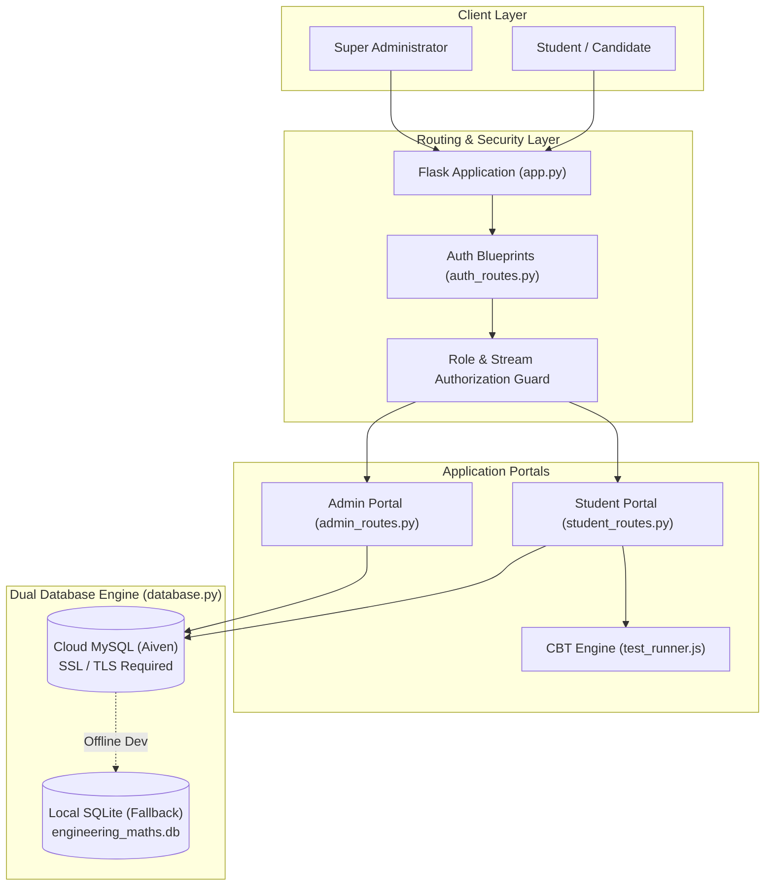

<div align="center">

# 📐 TechEasy Tutorials
### **Engineering Mathematics Education Portal & CBT Examination System**

[](https://python.org)
[](https://flask.palletsprojects.com/)
[](https://aiven.io)
[](https://www.mathjax.org/)
[](static/css/style.css)

<br/>

**A full-featured academic portal engineered for university Engineering Mathematics curriculum.**  
Featuring stream isolation (**Degree B.E./B.Tech** vs. **Diploma Polytechnic**), real-time **MathJax 3** formula rendering, an authentic **Computer-Based Testing (CBT)** exam simulator, and super-admin controls connected to an **online Cloud MySQL database**.

[🚀 Live Setup](#-quick-start-guide) • [✨ Key Features](#-features-overview) • [🏛️ System Architecture](#️-system-architecture) • [🔐 Test Credentials](#-default-administrator-credentials) • [📁 Directory Tree](#-directory-structure)

---

</div>

<br/>

## 🌟 Features Overview

### 🎓 Student Portal & Stream Isolation
Students experience a clean workspace filtered strictly by their academic course:

| Capability | Description |
| :--- | :--- |
| **Clean Student Dashboard** | Streamlined home session presenting the student's **Basic Profile Information** (Full Name, Student ID, Course Stream, Email, Mobile, Enrollment Date, and Verification Status). |
| **Stream Isolation** | **Diploma Students** see only Polytechnic syllabus (Basic & Applied Maths).<br/>**Degree Students** see only University B.E./B.Tech syllabus (Maths I to IV). Cross-stream URLs are blocked with instant security alerts. |
| **Chapter-Wise MCQ Practice** | Step-by-step mathematical explanations with instant evaluation. Live rendering of formulas ($\int f(x)dx$, $\frac{\partial^2 u}{\partial x^2}$, matrices $\begin{bmatrix} a & b \\ c & d \end{bmatrix}$, $\lambda, \theta$). |
| **CBT Mock Test Simulator** | Authentic online test engine with a live countdown timer, color-coded question palette, "Mark for Review" status, "Clear Response", and auto-submit upon timer expiry. |
| **Security & UX** | Interactive `👁️` show/hide password toggles on login/registration forms, 2-step password recovery, and persistent **Light/Dark theme** memory. |

---

### 🛡️ Super-Admin Portal
Complete super-admin oversight with granular stream separation:

- **Unified Management Dashboard:** Organized into 4 dedicated sessions:
  - 🏠 **Home Overview:** Global metrics across subjects, tests, questions, and students.
  - 🎓 **Degree Administration:** Manage Degree subjects, tests, and enrolled degree students.
  - 📐 **Diploma Administration:** Manage Diploma subjects, tests, and enrolled polytechnic students.
  - 👥 **Student Directory:** Instant stream toggle, filter, and management of active accounts.
- **Curriculum & Question Bank Builder:**
  - Create subjects, chapters, and sub-topics.
  - **Quick-Insert Math Toolbar:** One-click insertion of integrals, matrices, fractions, square roots, and Greek symbols.
  - **Live LaTeX Preview:** Real-time equation rendering while drafting questions and explanations.
  - Diagram upload support for question and answer options.
- **Mock Test Paper Generation & Analytics:**
  - Build custom CBT mock tests with time limit, question count, and stream association.
  - View detailed student attempt logs filtered strictly by enrolled stream.
- **Video Lecture Library:**
  - Curated YouTube lecture links with stream tagging and automatic thumbnail extraction.

---

## 🏛️ System Architecture



---

## 🗄️ Database Schema & Cloud Connectivity

The project uses an intelligent dual-dialect database abstraction layer in [`database.py`](file:///c:/Users/vivek/OneDrive/Desktop/engineering_maths/database.py) that automatically handles parameter substitution (`?` $\leftrightarrow$ `%s`) and SQL compatibility.

```text
├── users                # User authentication, roles, and course streams (Degree / Diploma)
├── subjects             # Academic subjects per course stream & semester
├── chapters             # Chapters organized by subject ID
├── topics               # Curriculum topics
├── questions            # MCQ questions, options, LaTeX formulas & diagrams
├── tests                # CBT Mock test paper definitions & time limits
├── test_questions       # Test-to-question association mapping
├── attempts             # Student mock test submissions & percentage scores
├── attempt_answers      # Individual question responses per attempt
├── test_results         # Chapter practice evaluation logs
└── video_lectures       # Stream-tagged YouTube tutorials
```

---

## 🚀 Quick Start Guide

### 1. Clone & Setup Virtual Environment
```bash
# Clone the repository
git clone https://github.com/vivekpunde05/TechEasy-Tutorials---Engineering-Mathematics-Portal.git
cd TechEasy-Tutorials---Engineering-Mathematics-Portal

# Create and activate virtual environment
python -m venv venv
# Windows:
venv\Scripts\activate
# Linux/macOS:
source venv/bin/activate
```

### 2. Install Dependencies
```bash
pip install -r requirements.txt
``

### 3. Configure Cloud Database (`.env`)
Create a `.env` file in the project root (reference template in [`.env.example`](file:///c:/Users/vivek/OneDrive/Desktop/engineering_maths/.env.example)):
```env
# Database Mode ('mysql' or 'sqlite')
DB_TYPE=mysql

# Cloud MySQL Credentials
MYSQL_HOST=your-mysql-host.aivencloud.com
MYSQL_PORT=12087
MYSQL_USER=avnadmin
MYSQL_PASSWORD=your_cloud_password
MYSQL_DB=defaultdb
MYSQL_SSL=true

SECRET_KEY=techeasy-engineering-maths-super-secret-key-2026
```

### 4. Run Data Migration (Optional)
If migrating from local SQLite to your online Cloud MySQL:
```bash
python migrate_to_mysql.py
```

### 5. Launch the Web Application
```bash
python app.py
```
Open your browser at **`http://127.0.0.1:5000`**

---

## 🔑 Default Administrator Credentials

| User Type | Email Address | Password | Access URL |
| :--- | :--- | :--- | :--- |
| **Super Administrator** | `admin@techeasy.com` | `admin123` | [`/admin/login`](http://127.0.0.1:5000/admin/login) |

> [!NOTE]
> Students can register directly from the homepage registration portal and select their course stream (**Degree** or **Diploma**).

---

## 🧪 Automated Test Suite

Run the 20 comprehensive unit and integration tests covering authentication, CBT submission, and stream isolation:

```bash
python -m unittest test_app.py
```
```text
Ran 20 tests in 8.4s
OK (All tests passed)
```

---

## 📁 Directory Structure

```text
TechEasy-Tutorials/
├── app.py                      # Application factory & Blueprint bootstrap
├── config.py                   # Dotenv loader & database configuration
├── database.py                 # Multi-dialect database engine (Cloud MySQL + SQLite)
├── migrate_to_mysql.py         # Cloud database migration tool
├── requirements.txt            # Project dependencies (Flask, PyMySQL, Pillow, dotenv)
├── test_app.py                 # Automated unit test suite (20 tests)
├── .env                        # Live environment secrets (git-ignored)
├── .env.example                # Configuration template
├── .gitignore                  # Git ignore rules
├── routes/
│   ├── auth_routes.py          # Login, registration, password reset & eye-toggle
│   ├── student_routes.py       # Student dashboard, practice sets, CBT engine
│   ├── admin_routes.py         # Admin sessions, curriculum CRUD, question bank
│   └── api_routes.py           # REST endpoints for dynamic frontend selects
├── static/
│   ├── css/style.css           # Vanilla CSS Design System (Dark/Light mode)
│   └── js/
│       ├── main.js             # Theme switcher & password toggles
│       ├── test_runner.js      # Interactive Computer-Based Test (CBT) engine
│       └── admin.js            # Math toolbar, LaTeX preview & dynamic selects
├── templates/
│   ├── base.html               # Master layout with MathJax 3 & dynamic navigation
│   ├── index.html              # Clean portal gateway landing page
│   ├── auth/                   # Authentication forms (login, register, reset)
│   ├── student/                # Basic info dashboard, practice sets, CBT runner
│   └── admin/                  # Multi-tab admin dashboard, questions, test builder
└── uploads/                    # Uploaded diagram images
```

---

## 📜 License
Developed for academic assessment and educational engineering education. All rights reserved.

<div align="center">
  <sub>Built with ❤️ by Vivek Punde | Powered by Flask, Cloud MySQL, and MathJax</sub>
</div>
